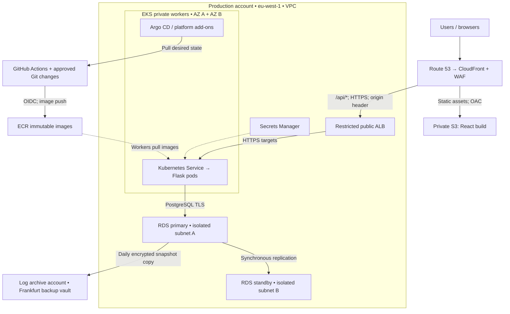

# Innovate Inc. — AWS cloud architecture

**Status:** Proposed architecture • **Reviewed:** 15 October 2026 • **Scope:** Architecture assignment

## Executive decision

Use AWS with **Amazon EKS for Flask**, **S3 and CloudFront for React**, and **Amazon RDS for PostgreSQL with a Multi-AZ DB instance deployment**. Separate production from non-production at the account, network, cluster, and database levels. Start in one AWS Region across two Availability Zones (AZs); use a second Region for backups and disaster recovery.

This design prioritizes a small operations team's ability to maintain a secure service. It meets the managed Kubernetes requirement without running the database, frontend web servers, or a large observability stack inside Kubernetes. EKS has a meaningful fixed cost at a few hundred daily users; if Kubernetes were optional, ECS/Fargate or a managed application platform would deserve a separate cost and operating-effort comparison. AWS is selected for its integrated EKS/RDS/IAM tooling and a coherent single-cloud implementation, not because GCP cannot meet the requirements.

This is a design deliverable, not an implemented deployment. No cloud resources are created by these files. Capacity numbers and recovery objectives below are proposed starting points to validate, not measured results.

## Contents

1. [Assumptions and objectives](#1-assumptions-and-objectives)
2. [High-level architecture](#2-high-level-architecture)
3. [Accounts and governance](#3-accounts-and-governance)
4. [VPC and network security](#4-vpc-and-network-security)
5. [Kubernetes and scaling](#5-kubernetes-and-scaling)
6. [Container delivery and CI/CD](#6-container-delivery-and-cicd)
7. [PostgreSQL and recovery](#7-postgresql-and-recovery)
8. [Operations and application security](#8-operations-and-application-security)
9. [Cost model and growth](#9-cost-model-and-growth)
10. [Implementation and acceptance](#10-implementation-and-acceptance)
11. [Sources](#11-sources)

Supporting files: [design decisions](decisions.md), [recovery runbook](runbooks/disaster-recovery.md), [review checklist](review-checklist.md), [editable diagram](diagrams/high-level.mmd).

## 1. Assumptions and objectives

| Area | Design assumption / proposed target |
| --- | --- |
| Team | Small team with limited cloud experience; nominate a platform owner and backup owner |
| Primary location | `eu-west-1` (Ireland); confirm customer geography and permitted data locations before implementation |
| Recovery location | `eu-central-1` (Frankfurt), subject to legal and contractual approval of cross-region data copies |
| Application | Stateless REST API; no local persistent files or in-process user sessions |
| Availability | Initial application SLO: 99.9% successful eligible requests per rolling 30 days; define eligibility before launch |
| Performance | Initial p95 API latency objective below 500 ms for ordinary endpoints at agreed load, excluding uploads and long jobs |
| Data | Sensitive personal data; encryption, minimal retention, auditable access, no real production data in development |
| Regional disaster | Backup-and-restore: proposed RPO ≤24 hours, RTO ≤8 hours, subject to successful exercises |
| Scale | Daily user count is insufficient for sizing; measure peak RPS, concurrency, query cost, object sizes, and egress |

For perspective, 99.9% corresponds to 43.2 minutes of time-based unavailability in a 30-day month. The proposed request-based SLO uses a failed-request budget instead; these are not identical measures. A regional restore could exceed that monthly budget. If regional outages must also stay within it, the recovery architecture and budget must change.

## 2. High-level architecture

The embedded diagram renders on GitHub. A standalone SVG is included for readers without Mermaid support: [high-level.svg](diagrams/high-level.svg) or [PNG](diagrams/high-level.png).

Solid arrows denote requests or data movement; dashed arrows denote runtime dependencies. AWS manages the EKS control plane outside the worker-node subnets. NAT, administration paths, audit logging, and the separate non-production environment are omitted from this diagram for clarity and described below. The standby is not an API read target.

**Request path:** DNS directs the browser to CloudFront. The default behavior serves React files from a private S3 bucket using Origin Access Control (OAC). `/api` and `/api/*` route to an ALB and then to private Flask pods. PostgreSQL is reachable only from explicitly authorized application and migration workloads.

**Cache correctness:** Disable API caching initially; forward required authorization headers, cookies, query strings, and HTTP methods. Never cache personalized responses by accident. Cache hashed static assets with long immutable lifetimes; give `index.html` a short lifetime. A viewer-request function rewrites extensionless frontend routes to `/index.html`, excluding API paths. Do not use a distribution-wide error-to-HTML mapping that would hide API errors.

## 3. Accounts and governance

Recommend **five accounts** in one AWS Organization. Account boundaries reduce compromise and billing blast radius; they do not require five EKS clusters.

| Account | Purpose | Access / billing boundary |
| --- | --- | --- |
| Management | Organization, consolidated billing, account lifecycle | No application workloads; very limited administrative use |
| Security tooling | Delegated security administration, GuardDuty and security findings | Security operators; no routine application deployments |
| Log archive | Organization audit logs and protected backup copies | Workload roles can deliver logs/copies but cannot delete the archive |
| Non-production | Separate VPC and EKS cluster for dev/staging; test RDS | Developers have scoped access; synthetic or sanitized data only |
| Production | Live EKS, RDS, S3, CloudFront and ECR | Approved deployment roles; ordinary developer access is read-only |

This follows AWS's separation of management, security tooling, and log archive responsibilities [1–2]. Combining security and logs into one account would save some configuration effort, but not the principal workload costs; retaining the separation protects evidence from routine security tooling changes. A dedicated staging account becomes useful if staging needs production-like access isolation or separate ownership.

Use AWS Organizations and, where suitable, Control Tower to establish these accounts. Use IAM Identity Center federation with MFA, role-based permission sets and short sessions. Keep an audited break-glass procedure with MFA; no shared root credentials or long-lived CI access keys. Service control policies restrict disabling audit controls, leaving the organization, and unauthorized Regions, with deliberate exceptions for required global services. SCPs do not protect the management account itself [1].

Centralize an organization CloudTrail trail in the log archive account with encryption, log validation and approved retention. Restrict KMS key deletion as well as log deletion. Delegate GuardDuty/security findings to the security tooling account. Tag resources with `Environment`, `Service`, `Owner`, and `CostCenter`; activate cost allocation tags, account-level budgets and anomaly alerts. Budgets notify owners; they are not spending caps.

## 4. VPC and network security

### 4.1 Addressing and routing

Production uses `10.20.0.0/16`; non-production uses `10.30.0.0/16`, with no default peering between them. Reserve non-overlapping address ranges for future VPCs and VPN clients. Verify these ranges against any existing networks before provisioning.

| Tier | AZ A | AZ B | Default route / purpose |
| --- | --- | --- | --- |
| Public | `10.20.0.0/24` | `10.20.1.0/24` | Internet gateway; ALB and one NAT gateway per AZ |
| Private application | `10.20.16.0/20` | `10.20.32.0/20` | Same-AZ NAT for permitted outbound internet access; EKS nodes and pod IPs |
| Isolated database | `10.20.64.0/24` | `10.20.65.0/24` | Local VPC routes only; RDS subnet group |

Enable VPC DNS support/hostnames. Worker nodes have no public IPs. Each production private route table uses its local zonal NAT gateway, avoiding a single NAT/AZ dependency. The small non-production environment may use one NAT with accepted interruption risk. Add an S3 gateway endpoint; evaluate paid interface endpoints for ECR, Secrets Manager, STS, logs and other APIs against NAT traffic and security needs. An EKS service interface endpoint is not a substitute for private Kubernetes API connectivity [3–4].

Use the VPC CNI, monitor available subnet IPs, and evaluate prefix delegation as density rises. Reserve a third AZ's address space before growth. Neither subnet size nor a daily-user forecast establishes actual pod capacity.

### 4.2 Traffic policy

| Path | Control |
| --- | --- |
| Browser → CloudFront | HTTPS, ACM certificate, WAF managed rules and rate limits, Shield Standard |
| CloudFront → ALB | HTTPS 443; ALB SG permits CloudFront origin-facing managed prefix list only; listener requires a rotated secret origin header; default deny |
| ALB → API pods | HTTPS target port 8443; application/node SG permits it only from ALB SG; health-check port explicitly allowed |
| API → RDS | PostgreSQL 5432 only from the API pod security group; separate migration pod SG when required |
| Pods → other pods | Default-deny ingress/egress NetworkPolicies with explicit DNS, application, metrics and AWS-dependency exceptions |
| Operators → Kubernetes API | Private endpoint only; authenticated VPN/private management path and EKS access entries plus Kubernetes RBAC |
| Workloads → AWS | Scoped Pod Identity roles, TLS and approved endpoint/NAT paths |

CloudFront's prefix list alone admits traffic from other CloudFront distributions; the origin header binds access more narrowly. Protect its value in configuration/state and logs and rotate it. This is a deliberate public-origin design with restricted access; an internal ALB with a CloudFront VPC origin is an alternative if its feature constraints fit [5].

Terminate viewer TLS at CloudFront, use TLS again to the ALB, and HTTPS targets to Gunicorn. Automate target-certificate renewal and rolling reloads. ALB HTTPS targets encrypt traffic but do not provide application-level mutual TLS or backend certificate validation; if authenticated service-to-service identity is required, introduce an explicitly designed mTLS solution. Certificates at CloudFront use ACM in `us-east-1`; the ALB certificate is regional and matches the origin hostname.

Enable supported VPC CNI NetworkPolicy enforcement and security groups for pods; test their combined behavior with the chosen CNI version and enforcing mode [3]. Namespace labels alone provide no network isolation. Restrict who can change pod selectors, service accounts and policies. Permit the platform's DNS, kubelet/control-plane, webhooks, image retrieval and telemetry paths deliberately; do not apply a blanket deny to system namespaces without testing.

Use SGs and NetworkPolicies as primary controls, leaving NACLs simple. NAT provides connectivity, not domain-based filtering. If third-party destinations must be allowlisted by hostname, add an egress proxy/firewall and account for its cost. Capture VPC Flow Logs with retention appropriate to investigations.

## 5. Kubernetes and scaling

### 5.1 Launch platform

Provision one EKS cluster per workload account: production and shared dev/staging non-production. Select a supported Kubernetes minor version at implementation, pin add-on/chart versions, test upgrades in staging and upgrade before extended support. Do not hardcode a version described as “latest” into a long-lived design [6].

Production starts with an On-Demand managed node group across two AZs, **minimum/desired 2, maximum 6**. Use general-purpose Graviton instances around 2 vCPU / 8 GiB per node as a sizing hypothesis, after verifying ARM compatibility. Keep enough allocatable capacity on a surviving node for essential add-ons and minimum API service under the agreed initial load. If that does not fit, increase the baseline before launch. Managed node-group AZ balance, actual pod placement, and AZ-loss behavior must be tested; a multi-AZ subnet list alone does not prove resilience.

Initially share this small node group between platform add-ons and the API, using requests, quotas and PriorityClasses. Avoid dedicated idle node groups before there is a scheduling reason for them. Use Cluster Autoscaler with managed node groups; it adds nodes for unschedulable pods and removes eligible spare capacity. EKS does not automatically resize workers just because HPA creates pods.

Install and pin VPC CNI, CoreDNS, kube-proxy, AWS Load Balancer Controller, Metrics Server, Cluster Autoscaler, EKS Pod Identity Agent, Secrets Store CSI driver/AWS provider, and Argo CD. Give each AWS-integrated controller its own scoped IAM role. Use EBS CSI only if an actual persistent-volume workload needs it.

### 5.2 Application allocation

| Setting | Proposed starting value | Reason / validation |
| --- | --- | --- |
| API replicas | Minimum 2, HPA maximum 10 | Baseline redundancy and bounded growth |
| Requests per API pod | 250m CPU, 512 MiB memory | Scheduling baseline; adjust from load-test measurements |
| Limits per API pod | 1 vCPU, 1 GiB memory | Bound resource use; monitor throttling and OOM events |
| HPA | CPU utilization target 65% of requested CPU | Metrics Server required; requests must be defined [7] |
| Scale-down stabilization | 300 seconds | Reduce oscillation after bursts |
| Rolling update | `maxUnavailable: 0`, `maxSurge: 1` | Keep serving replicas while replacing pods; reserve surge capacity |
| Disruption budget | `minAvailable: 1` for minimum two replicas | Permit controlled maintenance; does not prevent involuntary AZ failures |
| Placement | Spread across zones and hosts, `maxSkew: 1` | Prefer soft zone spread for recovery flexibility; verify normal distribution |

A CPU-based HPA may miss database/I/O bottlenecks. Add request rate or queue-depth metrics once measurements justify them. At ten pods the stated requests alone total 2.5 vCPU and 5 GiB, excluding add-ons and rollout surge; node scaling must leave headroom. CPU utilization percentages refer to requests, not the instance's full CPU capacity.

Use startup, readiness and liveness probes with distinct purposes. Liveness checks process health, not database availability, to avoid restart storms. Readiness reflects ability to serve, with cautious dependency checks. Drain connections gracefully during termination and align pod grace periods, application timeouts and ALB deregistration. Test the controller's pod readiness gates and rollout behavior.

Run pods as non-root with a read-only root filesystem, dropped Linux capabilities, `RuntimeDefault` seccomp, no privilege escalation and tightly scoped service accounts. Enforce Pod Security Admission restricted policies for application namespaces. Use `ResourceQuota` and `LimitRange` in dev/staging. Store user uploads in a separate encrypted S3 bucket with authorization and retention controls; never in pod-local storage.

### 5.3 Growth platform

When workload diversity or scale makes fixed node groups inefficient, retain a small On-Demand system group and move application capacity to Karpenter-managed pools. Use compatible Graviton and x86 instance families, multiple sizes, and Spot for interruptible replicas with an On-Demand service floor. Set pool resource limits, disruption budgets and interruption handling. Keep controller capacity on reliable nodes. Do not let Karpenter and Cluster Autoscaler manage the same capacity.

Spot is a cost optimization, not guaranteed capacity. Before adoption, validate eviction handling, graceful termination, topology spread, image architecture compatibility and fallback capacity. Expand to three AZs when availability/capacity requirements justify the extra baseline and networking cost.

## 6. Container delivery and CI/CD

**Flask:** Use a multi-stage Docker build with pinned Python dependencies and a minimal, patched runtime. Run Gunicorn, not Flask's development server. Set worker count and timeouts from CPU/memory and workload measurements. Keep database passwords and other secrets out of image layers, build arguments and Git.

**React:** Build once in CI and publish versioned static assets to S3. The browser bundle contains only public configuration. There is no benefit in allocating EKS pods to serve these static files initially.

**Registry:** Private ECR per environment/account, immutable release tags and deployments pinned by digest. Scan dependencies and images, create an SBOM and provenance, sign release images, and enforce release verification in the promotion gate. Build/test `linux/arm64` and `linux/amd64` manifests if both architectures are supported. Replicate retained release images to the DR Region; lifecycle rules must preserve active and rollback versions.

### Delivery sequence

1. Pull request: lint, unit/integration tests against a disposable PostgreSQL database, dependency/secret scanning, image build and IaC validation. Untrusted fork PRs receive no deployment credentials.
2. Merge: GitHub Actions obtains short-lived AWS credentials through OIDC. Restrict role trust to the repository, workflow/environment and intended branch; separate production and non-production roles.
3. Build, scan and sign the backend image once. Publish it to non-production ECR, then promote the verified digest into production ECR without rebuilding. Verify multi-architecture digest preservation when copying manifests.
4. Update the staging Helm values/GitOps repository with the image digest. Argo CD, running inside the cluster, pulls Git and reconciles desired state. CI does not need public access to the private Kubernetes API.
5. Run integration and smoke tests. Execute schema migrations as a single controlled Job with a dedicated database role, timeout and migration lock.
6. Approve the production environment/change. Merge the production digest update; Argo CD performs a rolling rollout. Automatically check synthetic requests, API errors and latency.
7. If the release fails, revert the Git change to the prior digest and verify reconciliation. Roll back frontend `index.html` to the compatible release and invalidate only the necessary paths.

Use backward-compatible expand/migrate/contract database changes. Do not automatically reverse destructive migrations during an application rollback. Delay dropping old columns until all running/rollback versions no longer need them.

Terraform owns accounts, VPC, EKS, IAM, RDS, registry, storage and delivery infrastructure. Helm/GitOps owns application resources; define one owner per resource. Keep separate encrypted, versioned, access-restricted remote states with locking per environment. Treat state as sensitive. Bootstrap state storage and the private EKS access path before installing in-cluster providers/add-ons. Infrastructure jobs that need Kubernetes access run on ephemeral private runners; ordinary GitHub-hosted application builds need only public AWS APIs. Argo CD reconciles drift; reviewed Terraform plans detect infrastructure drift.

## 7. PostgreSQL and recovery

Choose **RDS for PostgreSQL, Multi-AZ DB instance deployment with one synchronous standby**, using encrypted gp3 storage. This minimizes database operating work while preserving PostgreSQL compatibility. Do not run production PostgreSQL as a Kubernetes StatefulSet for this team.

Start by load-testing a small Graviton database class, approximately `db.t4g.medium`, with 100 GiB storage and a proposed 500 GiB autoscaling ceiling. These are provisional, not validated requirements. Monitor CPU credit balance for burstable classes; move to a non-burstable class for sustained demand. Select a currently supported engine version compatible with extensions and the application.

The standby supports failover, **not reads**. RDS documents typical failover of 60–120 seconds, which is not a guaranteed application recovery time [8]. Applications must discard broken connections, re-resolve the database endpoint, retry with bounded backoff, and make retried writes safe. Keep connection pools small and bounded. For example, 10 pods × 2 Gunicorn workers × 5 maximum connections per worker = 100 connections, plus migrations and operational reserve. Verify this against the chosen database's configured limit. Add RDS Proxy if connection churn or measured scale warrants its cost.

Use separate application, migration and administrative database users. The application cannot create/drop arbitrary schema or act as a superuser. Enforce PostgreSQL TLS with client certificate/hostname verification and trusted RDS CA bundles. Use customer-managed KMS encryption where cross-account backup portability requires it, deletion protection and a required final snapshot on approved deletion.

Retrieve runtime credentials from Secrets Manager through ASCP/CSI and Pod Identity [9]. A rotated secret file does not automatically refresh an existing connection pool; the application must reload credentials and reconnect, or use a controlled rollout. Test rotation before relying on it.

### Backup and continuity policy

| Failure | Mechanism | Proposed recovery objective |
| --- | --- | --- |
| Pod/node | Replica replacement and spare capacity | Stateless service recovery within minutes; verify with failure tests |
| RDS primary/AZ | Synchronous standby and managed failover | Target RPO 0 for committed data; application recovery target ≤5 minutes, validate |
| Accidental data change | Native RDS PITR, 14-day retention | Latest restorable time typically within ~5 minutes; restore target ≤2 hours for initial dataset |
| Regional outage | Daily encrypted snapshot copies to DR Region | Target RPO ≤24 hours only while completed-copy age stays ≤24 hours; RTO ≤8 hours |
| Compromised workload account | Cross-account protected snapshot in log archive | Recovery point based on last clean copy, not necessarily latest copy |

RDS supports automated retention up to 35 days; 14 days is this design's proposed policy [10]. Monitor `LatestRestorableTime` and snapshot-copy completion. A daily schedule alone does not guarantee a 24-hour RPO: copy duration, failures and operational delays matter.

Use AWS Backup scheduled snapshot copies to the log archive account in the approved DR Region. Configure AWS Organizations backup policies/cross-account permissions, source/destination customer-managed KMS policies and destination vault permissions, then prove a restore into the recovery environment. Cross-account/cross-region snapshot copies are discrete recovery points, not continuous PITR [11]. Retain daily copies for 30 days and monthly snapshots for 12 months, subject to the actual data-retention/deletion policy. Apply vault protection/immutability only after agreeing its retention implications and testing recovery.

The DR Region has approved quotas, Terraform configuration, mirrored images, accessible secrets/keys and versioned frontend artifacts, but no continuously running EKS/RDS stack. Infrastructure must be recreated during recovery. Protect and reproduce any uploads separately using S3 versioning and approved replication/backups; monitor their lag independently. Recovering only PostgreSQL does not recover user files.

Restore to a new RDS instance, validate integrity, then update the application's endpoint/secret and reconcile the deployment. Do not overwrite the only surviving database. See the [recovery runbook](runbooks/disaster-recovery.md). Exercise a restore before launch and quarterly thereafter, measuring provisioning, data restore, secret access, DNS/CloudFront cutover and application verification time. If tighter regional RPO/RTO is required, add a cross-region replica and warm application capacity after evaluating cost and replication lag.

## 8. Operations and application security

Start with CloudWatch logs, metrics, dashboards and alarms, plus managed RDS metrics and EKS control-plane audit logs. Collect container logs with Fluent Bit and expose application metrics through an OpenTelemetry collector. This avoids operating Prometheus, Grafana and Loki as three additional stateful systems at launch. Reassess managed Prometheus/Grafana when query, retention and dashboard requirements justify them.

| Signal | Action |
| --- | --- |
| API 5xx / synthetic availability | Page service owner for sustained errors or rapid error-budget burn |
| p95 latency / request rate | Investigate saturation and dependencies; do not assume more pods fix the database |
| Unschedulable pods / unavailable replicas | Page for sustained production capacity failures |
| Node pressure, OOM, throttling, subnet IPs | Adjust allocation/capacity; prevent scheduling exhaustion |
| DB connections, CPU credits, storage, locks, latency | Investigate before increasing application replica ceilings |
| Backup/copy failure or stale restore point | Page backup owner; flag recovery objective as at risk |
| Security findings / privileged changes | Triage through named security owner |
| Cost anomalies / budgets | Notify owner with environment and service attribution |

Propose 30-day application log retention and a separately approved longer audit retention; adjust for legal requirements and cost. Redact tokens, passwords, request bodies and personal fields. Restrict log queries and downloads. Configure actionable alert routing and a backup contact; a dashboard without an owner is not an operating model.

Application security remains necessary: use a managed OIDC identity provider, validate issuer/audience/expiry, enforce object-level authorization, parameterize SQL, validate inputs, and rate-limit sensitive workflows. Use secure cookies/CSRF protection when cookie authentication is chosen. WAF is an additional filter, not a substitute for authorization or secure code.

Platform ownership includes Kubernetes/add-on and node-image updates, security patches, certificate rotation, resource limits, quota reviews and incident response. AWS manages the EKS control plane and RDS service infrastructure; it does not operate the application or choose safe application capacity settings.

## 9. Cost model and growth

The principal cost risk at launch is paying for a resilient Kubernetes baseline while traffic is low. Five accounts do not imply five clusters, and separate dev/staging namespaces avoid a third EKS control-plane charge.

At the checked standard-support rate of **$0.10/cluster-hour**, two continuously running clusters cost **2 × 730 × $0.10 = $146/month for control planes alone** [12]. Extended-support pricing is $0.60/cluster-hour, making lifecycle management financially significant. Worker compute and all other services are additional.

| Cost item | Budget calculation / controlling variable |
| --- | --- |
| EKS | Cluster count × monthly hours × support-tier rate |
| EC2 workers and EBS | Instance hours by architecture/purchase option + disk capacity; include non-production |
| RDS | Both primary and standby compute/storage, backups and copy transfer |
| Network | Two production zonal NAT gateways + non-production NAT; NAT data processing; ALB hours/LCUs; public IPv4; inter-AZ transfer |
| Edge/frontend | CloudFront requests/egress and plan terms, WAF rules/requests, S3 storage/requests |
| Operations/security | Log ingestion/retention, metrics, CloudTrail choices, GuardDuty, Secrets Manager, KMS and backup vault storage |
| Administration | VPN/private runner hours, CI usage, support plan and applicable taxes |

Before approval, produce an AWS Pricing Calculator estimate for Ireland with measured traffic/egress assumptions and current instance rates. **This document does not claim a verified all-in monthly quote.** A few hundred visitors does not mean the service will cost only a few dollars. Begin with On-Demand usage; buy Savings Plans/reservations only after measuring a stable baseline. Scale down non-production workers where appropriate, but remember an idle EKS control plane still incurs charges.

| Observed condition | Next change | Why not day one? |
| --- | --- | --- |
| CPU-bound API reaches its replica baseline | HPA + node autoscaling, then revise tested ceilings | Initial spare capacity is sufficient until evidence changes |
| High DB read load after query/index tuning | Read replica and explicit read routing | Replication lag complicates read-after-write consistency |
| Connection saturation | Tune pools; consider RDS Proxy | Additional managed service and cost |
| Sustained compute growth / varied shapes | Karpenter, diversified Spot, system/app pool split | More configuration and interruption handling |
| Slow independent work | SQS and separate idempotent worker Deployment | No workload requiring a queue is specified yet |
| Repeated expensive reads | Managed cache with explicit invalidation and failover behavior | Avoid extra state without measured value |
| Tight regional outage objectives | Warm standby, cross-region replica, rehearsed traffic failover | Launch backup-and-restore accepts longer recovery |

Millions of users require application and database engineering, quota increases and measured load tests; Kubernetes autoscaling alone does not guarantee that outcome. Cache safe content, optimize SQL/indexes, bound queues and concurrency, and test downstream limits before increasing HPA ceilings.

## 10. Implementation and acceptance

1. Confirm geography, data classes, retention, budget, SLO/RPO/RTO and support ownership.
2. Establish organization/accounts, access, audit, KMS, budgets and Terraform state.
3. Build non-production VPC/EKS/RDS, private administration path and platform add-ons.
4. Containerize/build the application, configure OIDC-based CI and GitOps, and prove staged rollout/rollback.
5. Provision production and edge security; configure backup copies, secrets and monitoring.
6. Run load, isolation, failover and recovery exercises; document measured results and approve launch.

